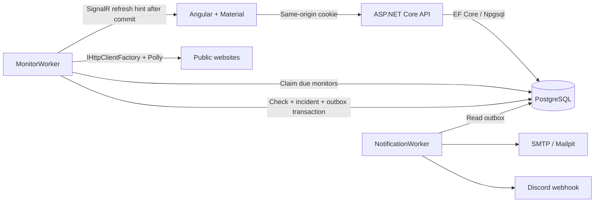

<div align="center">
  
  <h1>Uptime King</h1>
  <p>Uptime monitoring for client websites and applications.</p>

[](https://github.com/Vheissu/uptime-king/actions/workflows/ci.yml)


[](LICENSE)
</div>

Uptime King monitors client websites and applications. Group monitors by client, spot a failing site, inspect its check history, and get an email or Discord notification when it goes down or recovers.

The backend is ASP.NET Core on .NET 10, with EF Core and PostgreSQL for persistence. Hosted workers schedule HTTP checks and deliver alerts; SignalR tells the Angular dashboard when results change. Docker Compose runs the application locally. The .NET Aspire AppHost starts the development environment and connects its traces and metrics to the Aspire dashboard.


*Application screenshot with labelled sample data. Signing in opens a separate, initially empty workspace.*

## Run it

You'll need Docker with Compose. No local .NET or Node installation is needed for this route.

```sh
git clone https://github.com/Vheissu/uptime-king.git
cd uptime-king
./scripts/setup.sh
docker compose up --build -d
```

Open **[localhost:8099](http://localhost:8099)**. Explore the demo, then sign in using `UPTIME_PASSWORD` from the generated `.env` file. Add a public HTTP or HTTPS URL to start checking it. The first check usually appears within a few seconds.

The setup script generates unique database and workspace passwords. It leaves an existing `.env` untouched. The file is ignored by Git.

| Service | Local address |
| --- | --- |
| Dashboard | [localhost:8099](http://localhost:8099) |
| Mailpit inbox | [localhost:8029](http://localhost:8029) |
| API readiness | [localhost:5080/health/ready](http://localhost:5080/health/ready) |
| PostgreSQL | `localhost:54329` |

Local email goes to Mailpit, so you can try alerts without sending real mail. Add an address and enable email under **Notifications**. Discord delivery requires your own webhook. See [configuration and deployment](docs/operations.md) for SMTP settings, ports and hosting notes.

Stop with `docker compose down`. Database history and encryption keys survive restarts in named volumes. `docker compose down -v` deletes them.

## What it does

- Create, edit, pause and delete up to 100 monitors. Group them by client and filter by name or status.
- Open an incident after two consecutive failed checks and resolve it after a successful check. Acknowledge an outage without stopping its checks. Every unresolved incident stays visible alongside the latest 100 resolved incidents.
- Send outage and recovery alerts through email or Discord. The notification screen shows delivery attempts and failures.
- Inspect the latest 100 checks for a monitor, 30-day uptime, and a 24-hour response chart. Missing hours remain visible as gaps. Raw checks expire after 30 days; incident history remains.
- Receive live dashboard updates, with reconnection and a 30-second refresh fallback when the connection drops.

The public demo has six fictional sites, five clients and two incidents. Its `.example` hosts are never probed. Guest endpoints read only sample data, and management endpoints cannot change it.

<table>
<tr>
<td width="72%"></td>
<td width="28%"></td>
</tr>
</table>

## .NET architecture

The API and its workers run in one ASP.NET Core process. Feature folders separate HTTP endpoints, monitoring, notifications and persistence. Services receive their dependencies through constructor injection; each scheduled check gets its own async DI scope and EF Core `DbContext`. `TimeProvider` supplies the clock, and cancellation flows through database and network operations.



### How a check runs

1. **Claim available work.** `MonitorWorker` wakes every two seconds and fills its eight concurrent slots. `MonitorClaimStore` uses PostgreSQL's `FOR UPDATE SKIP LOCKED` to claim due monitors, gives each a two-minute lease and a new token, then commits. Network requests run outside that transaction. Free slots can be refilled while slower probes are still running.
2. **Probe the target.** A named `IHttpClientFactory` client sends a GET and reads response headers only. The Polly pipeline allows one transient retry with jitter, ten seconds per attempt and a 25-second total budget. Responses from 200 to 399 count as reachable; redirects aren't followed. There's no shared circuit breaker because one site's outage shouldn't suspend checks for another.
3. **Commit a valid result.** `MonitorRunner` locks the monitor row and checks the lease token again. A pause, edit, deletion or newer claim invalidates an older result. The check, monitor state, incident transition and outbox records commit together. EF Core manages persistence and migrations; PostgreSQL's partial unique index enforces one unresolved incident per monitor.
4. **Refresh the dashboard.** SignalR sends a bounded, best-effort hint after commit. The browser then fetches the current dashboard through the authenticated API. A failed broadcast can't undo a saved result or make a successful API write return an error.

Start with [`MonitorWorker`](src/UptimeKing.Api/Monitoring/MonitorWorker.cs), follow [`MonitorClaimStore`](src/UptimeKing.Api/Monitoring/MonitorClaimStore.cs) into [`MonitorRunner`](src/UptimeKing.Api/Monitoring/MonitorRunner.cs), then read the [EF Core model configuration](src/UptimeKing.Api/Data/UptimeDb.cs). The HTTP policy is in [`ProbeClientConfiguration`](src/UptimeKing.Api/Monitoring/ProbeClientConfiguration.cs).

### Notification delivery

Incident transitions queue alerts in the same transaction as the check result. A separate `BackgroundService` dispatches them through MailKit or a Discord webhook, with exponential backoff and a six-attempt limit. Each delivery has its own transaction, so cancellation during a later send doesn't roll back an earlier successful one. Recovery messages wait for the matching outage alert to succeed or exhaust its retries. Disabling a channel leaves its queued messages intact without consuming attempts.

Delivery is at least once. A process failure after sending but before committing can produce a duplicate. The dispatcher also holds a row lock while it sends, with a 20-second cancellation budget. Those are deliberate limits for this workload; see [`NotificationDispatcher`](src/UptimeKing.Api/Notifications/NotificationDispatcher.cs) for the transaction and ordering rules.

### Authentication and outbound requests

ASP.NET Core cookie authentication protects a single operator workspace. Sign-in is rate-limited, cookies are HTTP-only and SameSite Strict, and unsafe API requests require a CSRF header. Each authenticated request checks the password-version stamp in its encrypted ticket, so rotating or removing the configured password rejects existing sessions on their next request. Discord webhook tokens are encrypted with Data Protection and never returned by the API. Concurrent notification settings saves are serialized with a PostgreSQL advisory lock.

Client-supplied URLs are restricted to public HTTP/HTTPS destinations on standard ports. The connection handler validates every DNS answer and connects to an approved address directly, avoiding a second lookup. Private, loopback, link-local and reserved addresses are rejected, including Azure's platform address. Public IPv6 literals are supported. Probes disable redirects, cookies and proxies. The policy and address checks live in [`PublicEndpointPolicy`](src/UptimeKing.Api/Monitoring/PublicEndpointPolicy.cs).

### Measurements and browser state

Uptime is the fraction of successful recorded checks over 30 days, weighted by check count. Response averages include failures and retry time. The response chart uses its own 24-hour average, places points by timestamp and leaves missing hours disconnected. Periods without checks don't count as downtime. Demo detail views show hourly aggregates explicitly rather than presenting them as individual checks.

Angular combines live refresh hints and retries failed session and SignalR startup requests. Session and request version counters stop stale responses from replacing a newer login or restoring private data after logout. Nginx requires entry HTML to be revalidated, caches hashed assets, and returns 404 for missing bundles. The browser gets fresh entry HTML after a release without losing asset caching.

### Health and telemetry

`/health/live` reports that the API is running; `/health/ready` checks database connectivity. OpenTelemetry records ASP.NET Core requests, custom probe spans, the `uptime.checks` counter and the `uptime.check.duration` histogram. Aspire supplies the OTLP endpoint during development. HTTP client URL logging is disabled so configured URL secrets and webhook tokens don't end up in those logs.

The [architecture guide](docs/architecture.md) has the full incident state table, retention rules and deployment boundaries. The [review report](docs/code-review.md) connects the recent fixes to their regression tests.

## Develop with Aspire

Install the [.NET 10 SDK](https://dotnet.microsoft.com/download/dotnet/10.0), [Node.js 24 LTS](https://nodejs.org/), Docker and the [Aspire CLI](https://aspire.dev/get-started/install-cli/). Keep Docker running. Stop the Compose stack first to free the API port.

```sh
# Optional, if you use nvm:
nvm install
nvm use

cd src/UptimeKing.Web
npm ci
cd ../..
./scripts/dev.sh
```

The script starts the Aspire AppHost. Open the dashboard URL printed in the terminal, or go directly to [localhost:4200](http://localhost:4200). Aspire starts PostgreSQL, Mailpit, the API and Angular's development server.

The [AppHost](src/UptimeKing.AppHost/AppHost.cs) declares resource references, waits for PostgreSQL and API readiness, and supplies the database, SMTP and workspace configuration. Its dashboard exposes the Mailpit inbox and application telemetry. Aspire and Compose use separate database volumes.

Prefer to run the API and frontend yourself? Follow the [manual development setup](docs/operations.md#manual-development).

## Verify a change

```sh
dotnet tool restore
dotnet csharpier check .
dotnet build UptimeKing.slnx -c Release
dotnet test tests/UptimeKing.Tests -c Release

cd src/UptimeKing.Web
npm ci
npm run format:check
npm test
npm run build
```

The full solution build includes the Aspire AppHost and needs the prerequisites listed above. Backend tests use xUnit and `WebApplicationFactory`, with PostgreSQL and Mailpit started by Testcontainers. Docker must be running. Database concurrency and SMTP delivery are exercised against those services. Integration tests replace the outbound probe; focused HTTP tests check status handling, header-only reads, cancellation and sanitised errors.

The regression suite covers failures that can otherwise be hard to reproduce:

| Failure case | What the test checks |
| --- | --- |
| One probe stays slow while other slots finish | All nine distinct monitors begin checking with an eight-slot worker |
| Schedulers compete, a lease expires, or a result completes twice | Claims stay disjoint and stale or duplicate completions don't commit |
| Shutdown interrupts the second notification send | The first delivery remains committed |
| An outage alert keeps failing | Its recovery alert waits until opening delivery succeeds or exhausts its retries |
| A password changes or an old request finishes after a new login | The API rejects the old session and the frontend preserves the new one |
| An unresolved incident falls outside the latest 100 records | It remains on the dashboard |
| A chart has missing hours or a different reporting window | Time gaps and the 24-hour average remain correct |

Other tests cover demo isolation, input validation, concurrent settings saves, disabled notification channels, SignalR access and reconnects, CSRF headers, and logout cleanup. Frontend tests use Angular's Vitest runner.

[CI](.github/workflows/ci.yml) builds the complete .NET solution, runs both test suites, checks formatting, builds Angular, and starts the Docker stack to check readiness, demo data, entry HTML caching and missing-asset responses. The [verification notes](docs/verification.md) record browser checks and screenshots separately. Local SMTP delivery is verified through Mailpit; Discord request tests don't contact a live channel.

## Project layout

```text
src/UptimeKing.Api/
  Endpoints/       Session, dashboard and management API
  Monitoring/      Scheduler, HTTP probes and SignalR
  Domain/          Entities and monitor state transitions
  Notifications/   Transactional outbox and SMTP/Discord delivery
  Data/            EF Core context and isolated demo seed
  Migrations/      PostgreSQL schema history
src/UptimeKing.Web/ Angular standalone components, signals and Material
src/UptimeKing.AppHost/ Aspire resource graph
tests/UptimeKing.Tests/ Unit and PostgreSQL integration tests
```

## Scope

This is a self-hosted application for a single trusted operator or small team sharing one workspace. It checks from one location. The scheduler has eight concurrent slots, so sustained slow responses can delay checks beyond their configured interval.

Database claims tolerate competing workers, but the shipped deployment assumes one API instance. Multiple instances would need shared Data Protection keys, a SignalR backplane or service, a separate migration job, and a trusted-proxy/rate-limiting plan. Multi-user accounts, tenant isolation, regional probes and billing are outside the current scope. The Compose configuration is for local use; review the [hosting notes](docs/operations.md#hosting) before exposing an installation.

Built by [Dwayne Charrington](https://github.com/Vheissu). Interface research included [Better Stack on Mobbin](https://mobbin.com/screens/280299a6-26a7-4c8d-8c4e-1bd6429bca80); the implementation and screenshots here are Uptime King. Typography is Public Sans, with Phosphor icons and Angular Material controls.

[MIT licensed](LICENSE).
