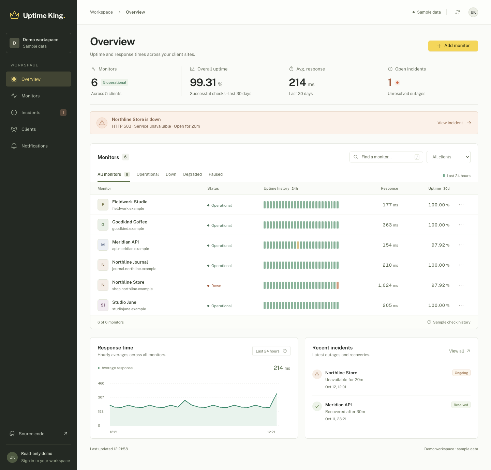
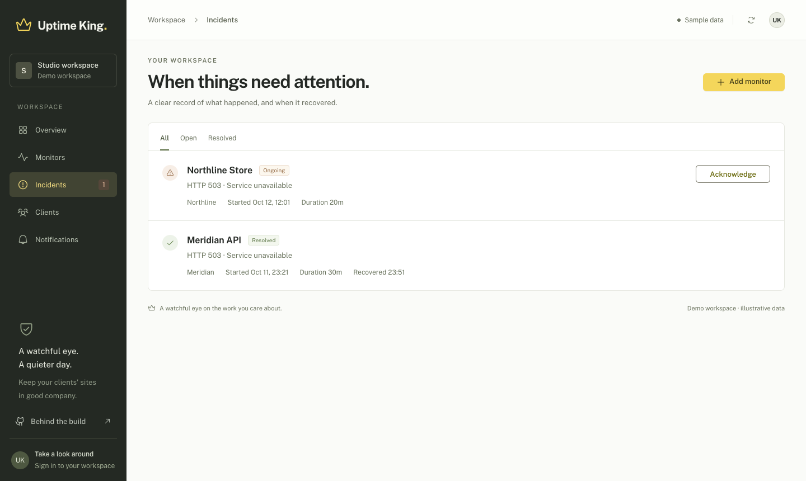
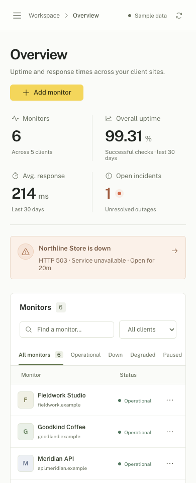
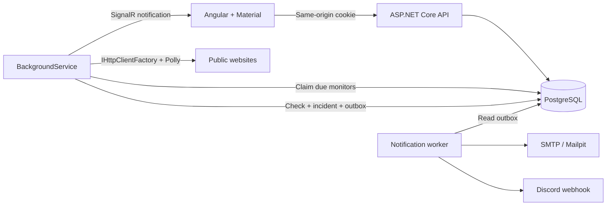

<div align="center">
  
  <h1>Uptime King</h1>
  <p>Uptime monitoring for client websites and applications.</p>

[](https://github.com/Vheissu/uptime-king/actions/workflows/ci.yml)


[](LICENSE)
</div>

Uptime King monitors client websites and applications. Group monitors by client, spot a failing site, inspect its check history, and get an email or Discord notification when it goes down or recovers.

Built with ASP.NET Core, Angular and PostgreSQL. The scheduler, incident tracking, live updates and notification delivery all run locally. Docker Compose gets the whole application running; .NET Aspire gives you a development environment with resource health, traces and metrics.



*Actual application screenshot. The public demo contains clearly labelled sample data; signing in opens a separate, initially empty workspace.*

## Run it

You'll need Docker with Compose. No local .NET or Node installation is needed for this route.

```sh
git clone https://github.com/Vheissu/uptime-king.git
cd uptime-king
./scripts/setup.sh
docker compose up --build -d
```

Open **[localhost:8099](http://localhost:8099)**. Explore the demo, then sign in using `UPTIME_PASSWORD` from the generated `.env` file. Add a public HTTP or HTTPS URL to start checking it. The first check usually appears within a few seconds.

The setup script generates unique database and workspace passwords. It leaves an existing `.env` untouched. The file is ignored by Git.

| Service | Local address |
| --- | --- |
| Dashboard | [localhost:8099](http://localhost:8099) |
| Mailpit inbox | [localhost:8029](http://localhost:8029) |
| API readiness | [localhost:5080/health/ready](http://localhost:5080/health/ready) |
| PostgreSQL | `localhost:54329` |

Local email goes to Mailpit, so you can try alerts without sending real mail. Add an address and enable email under **Notifications**. Discord delivery requires your own webhook. See [configuration and deployment](docs/operations.md) for SMTP settings, ports and hosting notes.

Stop with `docker compose down`. Database history and encryption keys survive restarts in named volumes. `docker compose down -v` deletes them.

## What it does

- **Client monitoring.** Create, edit, pause and delete up to 100 monitors. Filter by client, status or name; inspect recent checks without leaving the dashboard.
- **Scheduled HTTP checks.** A `BackgroundService` claims due work in PostgreSQL. `IHttpClientFactory` manages connections; Polly bounds attempts and retries transient failures.
- **Incident tracking.** Two consecutive failed checks open an incident. A successful check resolves it. Acknowledgement records that someone has seen it.
- **Live updates.** SignalR refreshes the dashboard after a check commits. Reconnect handling and a 30-second refresh fallback cover interrupted connections.
- **Email and Discord.** Incident transitions write an outbox record in the same transaction as the check. Delivery retries run separately from monitoring.
- **Useful history.** Thirty-day check-based uptime, hourly history bars, response charts and the latest 100 checks per monitor. Raw checks expire after 30 days; incidents remain.
- **A usable demo.** Six fictional sites, five clients and two incidents make the interface explorable immediately. Demo hosts use `.example`, are never probed, and cannot be changed through the management API.

<table>
<tr>
<td width="72%"></td>
<td width="28%"></td>
</tr>
</table>

## Inside the application



The application is intentionally one API process and one frontend. Feature folders keep endpoint handling, monitoring and notifications distinct without adding service boundaries that the workload doesn't need.

A few decisions worth reading in the code:

- **Claim, probe, commit.** Workers use `FOR UPDATE SKIP LOCKED` to claim due monitors, then release the transaction before doing network work. Lease tokens fence off late results after a pause, edit or newer claim.
- **No shared circuit breaker.** Each target has its own health. One client's outage must not stop checks for unrelated clients.
- **Bounded requests.** One retry, a 10-second per-attempt timeout and a 25-second total budget. Checks read response headers only; redirects are reported as reachable without following them.
- **Public destinations only.** URL validation and connection-time DNS checks reject private, loopback, link-local and reserved addresses. The socket connects to the validated address to avoid a second DNS lookup.
- **Durable alerts.** Outbox writes are atomic with incident transitions. Retries survive restarts. External delivery is at least once: a crash between sending and committing can produce a duplicate.
- **Small authentication surface.** One operator workspace, a shared password, an HTTP-only session cookie and CSRF request headers. Discord tokens are encrypted with ASP.NET Core Data Protection and never returned by the API.

[Architecture and behaviour](docs/architecture.md) covers state transitions, data consistency, measurement semantics and the current boundaries.

## Develop with Aspire

Install the [.NET 10 SDK](https://dotnet.microsoft.com/download/dotnet/10.0), [Node.js 24 LTS](https://nodejs.org/), Docker and the [Aspire CLI](https://aspire.dev/get-started/install-cli/). Keep Docker running. Stop the Compose stack first to free the API port.

```sh
# Optional, if you use nvm:
nvm install
nvm use

cd src/UptimeKing.Web
npm ci
cd ../..
./scripts/dev.sh
```

The script starts the Aspire AppHost. Open the dashboard URL printed in the terminal, or go directly to [localhost:4200](http://localhost:4200). Aspire starts PostgreSQL, Mailpit, the API and Angular's development server. Its resource dashboard exposes the Mailpit inbox and application telemetry. Aspire and Compose use separate database volumes.

Prefer to run the API and frontend yourself? Follow the [manual development setup](docs/operations.md#manual-development).

## Verify a change

```sh
dotnet tool restore
dotnet csharpier check .
dotnet test tests/UptimeKing.Tests

cd src/UptimeKing.Web
npm ci
npm run format:check
npm test
npm run build
```

Backend integration tests start real PostgreSQL and Mailpit containers through Testcontainers. Docker must be available. They cover API authentication, demo isolation, monitor changes, lease fencing, competing claims, scheduler capacity, concurrent completion, incident transitions, ordered outbox delivery, password rotation and SignalR access. Network probes are replaced in integration tests; focused probe tests exercise HTTP status, header-only reads, cancellation and error handling.

Frontend tests cover stale refresh responses, guest/workspace separation, network recovery, session races, reconnection, chart gaps, CSRF headers and error responses. CI builds the complete .NET solution including the Aspire AppHost, runs both suites, checks formatting, builds the frontend, and starts the Docker stack for a smoke test. Browser verification and screenshots are documented in [verification notes](docs/verification.md). The [review findings](docs/code-review.md) explain the failure cases covered by the regression tests.

## Project layout

```text
src/UptimeKing.Api/
  Endpoints/       Session, dashboard and management API
  Monitoring/      Scheduler, HTTP probes and SignalR
  Domain/          Entities and monitor state transitions
  Notifications/   Transactional outbox and SMTP/Discord delivery
  Data/            EF Core context and isolated demo seed
  Migrations/      PostgreSQL schema history
src/UptimeKing.Web/ Angular standalone components, signals and Material
src/UptimeKing.AppHost/ Aspire resource graph
tests/UptimeKing.Tests/ Unit and PostgreSQL integration tests
```

## Scope

This is a self-hosted application for a single trusted operator or small team sharing one workspace. It checks from one location and reports the result it observes. It isn't an SLA calculator: uptime is the fraction of successful recorded checks, and periods without checks are not counted as downtime.

Multi-user accounts, tenant isolation, distributed SignalR, regional probes and billing are outside the current scope. The Compose configuration is for local use; review the [hosting notes](docs/operations.md#hosting) before exposing an installation.

Built by [Dwayne Charrington](https://github.com/Vheissu). Interface research included [Better Stack on Mobbin](https://mobbin.com/screens/280299a6-26a7-4c8d-8c4e-1bd6429bca80); the implementation and screenshots here are Uptime King. Typography is Public Sans, with Phosphor icons and Angular Material controls.

[MIT licensed](LICENSE).
